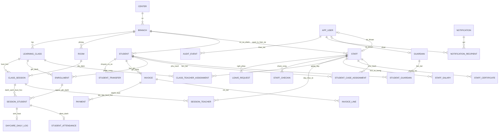

# Thiết kế database — Trung tâm Dương An

Phiên bản thiết kế: 1.0 · Ngày 22/10/2026.

## 1. Phạm vi và các quyết định

Thiết kế dựa trên bản yêu cầu website, `frontend/src/types/index.ts` và các luồng demo. PostgreSQL là lựa chọn theo yêu cầu ban đầu; dự án Java hiện có vẫn dùng driver MySQL và Compose MySQL. Bộ thiết kế này nằm riêng trong `database/`, chưa thay cấu hình Java hoặc kết nối frontend.

- **Một trung tâm, nhiều cơ sở**. Đây chưa phải hệ thống SaaS nhiều tổ chức. Bảng `center` được ràng buộc tối đa một dòng; không thêm `tenant_id` hình thức mà thiếu kiểm soát cách ly.
- Chính xác **ADMIN, TEACHER, PARENT**. Mỗi tài khoản mang một vai trò. Nhân viên không cần đăng nhập có thể chưa có tài khoản; nhân viên quản trị có thể liên kết tài khoản ADMIN.
- UUID là khóa chính nghiệp vụ; `code` là mã hiển thị như HS001, NV001. Không dùng mã có thể sửa làm khóa ngoại. `audit_event.id` dùng bigint identity vì chỉ cần thứ tự nội bộ.
- `date` cho ngày sinh/ngày nghỉ; `timestamptz` cho thời điểm buổi học/giao dịch. Backend nhận thời gian có offset và hiển thị theo `Asia/Ho_Chi_Minh`.
- Khoảng hiệu lực ghi danh/phân công/lương là **[ngày bắt đầu, ngày kết thúc)**: ngày kết thúc không còn hiệu lực, NULL là chưa có hạn. Đơn nghỉ phép/ngày lễ dùng hai ngày **bao gồm cả ngày cuối**.
- Tiền VND dùng `numeric(...,0)`, không dùng float/double. Phạm vi V1 chỉ thanh toán một phiếu học phí mỗi lần, cho phép thanh toán nhiều lần.
- Độ tuổi, sĩ số hiện tại, tổng học sinh, công nợ là dữ liệu tính toán; không lưu cột tổng trùng lặp để tránh sai lệch.
- Giữ hồ sơ và lịch sử bằng trạng thái kết thúc/hủy/khóa. Không xóa dây chuyền học phí, điểm danh, nhân sự như bản demo.
- SQL triển khai lõi giai đoạn 1 và nền dữ liệu đơn giản cho tài liệu, thông báo, chuyển cơ sở, sinh hoạt bán trú. Kế hoạch/báo cáo chuyên sâu, khảo sát và đánh giá chỉ thiết kế hướng mở rộng ở mục 10.

## 2. Sơ đồ quan hệ tổng thể

Sơ đồ rút gọn nhóm quan hệ chính. SQL là nguồn chính xác cho đầy đủ cột, NOT NULL, FK và các ràng buộc. `BRANCH_HOLIDAY`, `DOCUMENT` là danh mục phụ gắn cơ sở.

## 3. Danh mục bảng và ý nghĩa

### Tổ chức, tài khoản và hồ sơ

| Bảng | Nội dung chính | Quan hệ/ràng buộc đáng chú ý |
| --- | --- | --- |
| `center` | Trung tâm, tên, múi giờ, địa chỉ | Một trung tâm trong database V1 |
| `branch` | Cơ sở, mã, liên hệ, trạng thái | N cơ sở thuộc một trung tâm |
| `app_user` | Email đăng nhập, password hash, vai trò, trạng thái, token version | Email chuẩn hóa viết thường, duy nhất; không lưu mật khẩu thô/JWT thô |
| `staff` | Hồ sơ nhân viên, cơ sở chính, chuyên môn, ngày vào/nghỉ việc | Tài khoản tùy chọn; composite FK chỉ cho ADMIN hoặc TEACHER |
| `guardian` | Hồ sơ người giám hộ/phụ huynh, liên hệ | Tài khoản tùy chọn; composite FK chỉ cho PARENT |
| `student` | Hồ sơ học sinh, ngày sinh, cơ sở hiện tại, trạng thái | Không lưu `age` hoặc mảng lớp trong hồ sơ |
| `student_guardian` | Quan hệ người giám hộ–học sinh | N–N; quyền xem cổng phụ huynh, đón trẻ, liên hệ chính, thời điểm thu hồi |
| `student_case_assignment` | Lịch sử giáo viên phụ trách hồ sơ | Tối đa một giáo viên phụ trách chính tại một thời điểm |
| `staff_certificate` | Chứng chỉ, nơi cấp, hiệu lực, khóa file | N chứng chỉ/nhân viên; file lưu object storage riêng |
| `staff_salary` | Lương cơ bản theo khoảng hiệu lực | Không chồng lấn lịch sử lương của một nhân viên; chưa tính bảng lương |

Một trẻ có thể có cả bố và mẹ, một phụ huynh có nhiều con. Không ép quan hệ này thành `student.parent_id` duy nhất. Bảng nối còn biểu diễn quyền truy cập hiện tại, không suy ra quyền chỉ từ số điện thoại trùng nhau.

### Lớp và lịch học

| Bảng | Nội dung chính | Quan hệ/ràng buộc đáng chú ý |
| --- | --- | --- |
| `room` | Phòng, cơ sở, sức chứa | Mã phòng duy nhất trong cơ sở |
| `learning_class` | Lớp, hình thức, sức chứa, ngày mở/đóng | `INDIVIDUAL`, `GROUP`, `DAYCARE`; lớp cá nhân có capacity=1 |
| `class_teacher_assignment` | Phân công giáo viên theo ngày | Một giáo viên chính ở mỗi thời điểm; có thể có trợ giảng |
| `enrollment` | Lượt ghi danh vào lớp và thời gian hiệu lực | Không cho trùng khoảng ghi danh cùng học sinh/cùng lớp; được tham gia các lớp khác nhau |
| `class_session` | Buổi học cụ thể: lớp, phòng, bắt đầu/kết thúc, trạng thái | FK bảo đảm lớp/phòng cùng cơ sở; chặn trùng lớp và phòng |
| `session_teacher` | Đội ngũ thực tế từng buổi, gồm người dạy thay | Chặn trùng thời gian của giáo viên |
| `session_student` | Danh sách học sinh của từng buổi và nguồn ghi danh | FK khớp học sinh–lớp–ghi danh; chặn trùng lịch học sinh |
| `student_attendance` | Kết quả điểm danh, người ghi, thời điểm | Một kết quả/học sinh/buổi; bắt buộc nằm trong danh sách buổi học |

**Phân công lớp và danh sách từng buổi là hai khái niệm khác nhau.** Khi đổi giáo viên tháng sau, buổi học tháng trước vẫn ghi đúng người dạy. Khi trẻ nghỉ lớp, điểm danh cũ không mất. Khi tạo lịch ngày/tuần, server tạo các buổi cụ thể và sao chép danh sách hợp lệ vào hai bảng `session_*` trong cùng transaction.

Không có bản ghi `student_attendance` nghĩa là **chưa điểm danh**, không tự coi là vắng. Trạng thái đã ghi gồm `PRESENT`, `ABSENT`, `EXCUSED`, `LATE`. Công thức chuyên cần phải chỉ rõ mẫu số: đề xuất `(PRESENT + LATE) / tổng lượt đã điểm danh`, bỏ các buổi hủy; không dùng lượt chưa điểm danh làm vắng.

### Nhân sự, học phí và tiện ích

| Bảng | Nội dung chính | Quan hệ/ràng buộc đáng chú ý |
| --- | --- | --- |
| `staff_checkin` | Ngày làm việc, giờ vào/ra, người ghi, lý do điều chỉnh | Tối đa một bản ghi/người/ngày; V1 chưa có nhiều ca trong ngày |
| `leave_request` | Ngày nghỉ, lý do, trạng thái, người gửi/duyệt | Không tự duyệt đơn của chính tài khoản gửi; đơn đã duyệt không chồng ngày |
| `invoice` | Phiếu học phí theo học sinh, tháng, hạn thu | Một học sinh có thể có nhiều phiếu/tháng; tháng biểu diễn bằng ngày đầu tháng |
| `invoice_line` | Nội dung thu, số lượng, đơn giá, giảm trừ | Tổng dòng được DB tính, giảm trừ không vượt tiền dòng |
| `payment` | Phiếu thu, số tiền, hình thức, người thu, thông tin hủy | N lần thu/một phiếu; idempotency key chống ghi trùng request |
| `notification` | Tiêu đề/nội dung, nháp/công bố/lưu trữ | Thông báo toàn trung tâm hoặc thuộc cơ sở |
| `notification_recipient` | Người nhận cụ thể và thời điểm đọc | Không tự cấp quyền xem thông báo chỉ vì biết ID |
| `document` | Tài liệu nội bộ/tham khảo/biểu mẫu, file hoặc URL | Mỗi mục chỉ có một nguồn; không lưu binary trong bảng |
| `branch_holiday` | Ngày lễ/nghỉ theo cơ sở | Kiểm tra khi tạo/đổi lịch ở service |
| `student_transfer` | Yêu cầu/lịch sử chuyển cơ sở | Ghi cơ sở đi/đến và người hoàn tất |
| `daycare_daily_log` | Ghi nhận ăn, ngủ, sinh hoạt mỗi buổi/học sinh | Có FK tới danh sách buổi; service chỉ cho lớp DAYCARE |
| `audit_event` | Ai làm gì, đối tượng, request, thời gian | Server ghi trong transaction; không tự động thu thập bởi schema |

`invoice_balance` là **view**, không phải bảng: trả tổng học phí, tổng đã thu, còn nợ, `UNPAID/PARTIAL/PAID`. Trạng thái nghiệp vụ của phiếu là `DRAFT/ISSUED/VOID`; không trộn với trạng thái thanh toán. Phiếu quá hạn được tính bằng `due_on` và công nợ tại thời điểm truy vấn.

## 4. Các thay đổi so với dữ liệu frontend

| Demo hiện có | Thiết kế database |
| --- | --- |
| `Student.teacherId` | Phân công hiện hành trong `student_case_assignment` |
| `Student.parentId`, `Parent.studentIds[]` | `student_guardian`; loại bỏ hai nguồn dữ liệu mâu thuẫn |
| `SchoolClass.studentIds[]` | `enrollment`, truy vấn theo ngày hiệu lực |
| `SchoolClass.teacherId` | `class_teacher_assignment` và `session_teacher` khi dạy thực tế |
| `Session.date/start/end` | Hai thời điểm `starts_at/ends_at` có múi giờ |
| `Session.room` dạng chữ | `room_id` để kiểm tra trùng lịch chính xác |
| `Session.attendance` dạng map | Danh sách buổi + `student_attendance` |
| `Staff.certificate` dạng chữ | N dòng `staff_certificate` |
| `Staff.salary` | Lịch sử `staff_salary` |
| `Fee.amount/paidAt` | Phiếu, dòng chi tiết và nhiều phiếu thu; không mất lịch sử thanh toán từng phần |
| `checkins[staffId][]` | `staff_checkin` với thời gian và người ghi |
| Xóa học sinh và xóa dây chuyền | Chuyển trạng thái, kết thúc ghi danh, bảo toàn lịch sử |

API có thể tiếp tục trả DTO gần giống frontend hiện tại; việc ghép dữ liệu do service/query thực hiện. Không expose trực tiếp toàn bộ JPA entity.

## 5. Ràng buộc chống trùng lịch

SQL dùng khoảng `tstzrange(starts_at, ends_at, '[)')` và exclusion constraint. Buổi 08:00–09:00 và 09:00–10:00 không trùng; 08:30–09:30 có trùng. Đây là cơ chế PostgreSQL dành cho ràng buộc không chồng lấn khoảng thời gian, kết hợp `btree_gist` để so sánh ID tài nguyên. [Tài liệu PostgreSQL về range và exclusion](https://www.postgresql.org/docs/18/rangetypes.html#RANGETYPES-CONSTRAINT).

- `class_session`: hai ràng buộc riêng cho lớp và phòng.
- `session_teacher`: ràng buộc cho giáo viên, kể cả trợ giảng/dạy thay.
- `session_student`: ràng buộc cho học sinh, kể cả khi học ở hai lớp khác nhau.
- Trigger V2 lấy thời gian/trạng thái từ buổi học, khóa dòng buổi học bằng `FOR UPDATE`, không tin giá trị lặp do client gửi.
- Khi đổi giờ/hủy/mở lại buổi học, trigger cập nhật danh sách đã chốt. Vi phạm ở bất kỳ danh sách nào làm toàn bộ thao tác đổi lịch thất bại.
- Buổi hủy giữ lịch sử nhưng không chiếm tài nguyên. Mở lại phải kiểm tra trùng lần nữa.
- Danh sách giáo viên/học sinh **bắt buộc được tạo cùng buổi học qua service**. DB không tự suy ra danh sách từ phân công. Nếu bỏ qua bước này, DB chỉ có thể chặn phòng/lớp; không thể chặn tài nguyên chưa được khai báo.
- `DEFERRABLE INITIALLY IMMEDIATE` cho phép transaction đổi chỗ nhiều buổi bằng `SET CONSTRAINTS ALL DEFERRED`; vẫn kiểm tra trạng thái cuối khi commit.
- Service ánh xạ SQLSTATE `23P01` thành HTTP 409, báo lỗi nghiệp vụ; không trả nguyên thông tin nội bộ của SQL.

## 6. Phần DB bảo đảm và phần service phải thực hiện

Không diễn đạt quy tắc nhiều bảng bằng CHECK tham chiếu dữ liệu khác; PostgreSQL khuyến nghị dùng FK/UNIQUE/EXCLUDE cho những quan hệ phù hợp. [Tài liệu về constraints](https://www.postgresql.org/docs/18/ddl-constraints.html).

| Quy tắc | SQL hiện có | Bắt buộc ở Spring Boot |
| --- | --- | --- |
| Ba role, tài khoản gắn đúng loại hồ sơ | CHECK + composite FK | Kiểm tra tài khoản ACTIVE và JWT/token_version |
| Parent chỉ xem con được liên kết | Bảng liên kết và trạng thái thu hồi | Query scope theo user trong JWT, không theo ID người dùng gửi lên |
| Trùng lịch đã khai báo | EXCLUDE và trigger đồng bộ | Tạo đủ danh sách trong transaction, retry deadlock có giới hạn |
| Sĩ số, phòng đủ chỗ | Capacity dương; cá nhân capacity=1 | Khóa dòng lớp; kiểm tra **sĩ số tối đa theo từng thời điểm** của toàn khoảng ghi danh, rồi mới thêm; chặn giảm capacity dưới sĩ số |
| Hiệu lực ghi danh | Khoảng không đảo, không trùng cùng lớp/học sinh | Kiểm tra ngày buổi học nằm trong khoảng và trạng thái, cơ sở, lớp còn hoạt động |
| Chuyển người dạy/ghi danh | Lịch sử phân công và danh sách từng buổi | Cập nhật rõ các buổi tương lai được chọn; không tự sửa lịch sử |
| Điểm danh | Chỉ thành viên trong danh sách buổi; không trùng kết quả | Giáo viên đúng buổi hoặc Admin; buổi không hủy, quyền sửa quá khứ |
| Duyệt nghỉ phép | Trạng thái duyệt có người/thời gian; không tự duyệt; không chồng đơn đã duyệt | Người duyệt ADMIN; kiểm tra lịch dạy, phân công dạy thay hoặc đổi lịch trước khi duyệt |
| Thanh toán | Số tiền dương, khóa request duy nhất; view tổng hợp | Khóa phiếu thu học phí; kiểm tra ISSUED và tiền thu <= công nợ; thực hiện ghi thu và audit cùng transaction |
| Dòng học phí đã phát hành | Ràng buộc giá/giảm trừ | Chỉ sửa dòng lúc DRAFT; không sửa trực tiếp số tiền phiếu thu đã ghi nhận |
| Hủy chứng từ | Trường lý do/người/thời gian cho phiếu thu | Admin mới được hủy; phiếu học phí còn thu hợp lệ không được hủy; hoàn tiền thực cần nghiệp vụ giai đoạn 2 |
| Sinh hoạt bán trú | FK tới học sinh trong buổi, giờ ngủ hợp lệ | Lớp DAYCARE, giáo viên đúng buổi; giờ ngủ trong giới hạn phù hợp |
| Audit và dữ liệu lịch sử | Bảng và FK giữ liên kết | Ghi audit, cấm UPDATE/DELETE audit cho user runtime; tránh ghi mật khẩu/nội dung nhạy cảm vào JSON |

SQL là **schema thiết kế có kiểm thử**, chưa phải backend hoàn chỉnh. Các dòng ở cột service chưa được thực thi tự động bởi migration. Không cho client kết nối DB trực tiếp.

## 7. Transaction nghiệp vụ đề xuất

### Tạo/đổi lịch

1. Kiểm tra ADMIN, khóa dòng lớp/buổi cần sửa bằng `FOR UPDATE`.
2. Kiểm tra cơ sở, phòng, ngày nghỉ/lễ, trạng thái lớp và thời gian làm việc.
3. Xác định giáo viên/học sinh hợp lệ theo ngày; kiểm tra sĩ số/phòng.
4. Ghi buổi, giáo viên, học sinh, audit trong một transaction. Database chặn thời gian trùng kể cả khi hai request đến đồng thời.
5. Rollback khi lỗi; trả 409 cho xung đột và cho người dùng chọn giờ khác. Với `40P01`/`40001`, chỉ retry toàn transaction có giới hạn.

### Ghi nhận học phí

1. Kiểm tra ADMIN; đọc `idempotency_key`. Cùng key/cùng payload trả kết quả cũ; cùng key/khác payload trả 409.
2. `SELECT ... FROM invoice WHERE id=:id FOR UPDATE`.
3. Tất cả thao tác sửa dòng/ghi thu/hủy thu phải tuân thủ cùng khóa phiếu này. Đọc công nợ lại sau khi lấy khóa.
4. Kiểm tra phiếu ISSUED, tiền > 0 và không lớn hơn dư nợ. Tạo `payment` và audit.
5. Commit, đọc lại view. Ví dụ học phí 2.400.000đ, lần đầu 1.000.000đ → PARTIAL, còn 1.400.000đ; lần sau đủ → PAID.

Chưa hỗ trợ một phiếu thu chia nhiều học sinh, công nợ âm, hoàn tiền, thu thừa hoặc cổng thanh toán. Khi cần, thêm `payment_allocation` và sổ hoàn/điều chỉnh, không sửa số tiền lịch sử.

### Chuyển cơ sở

Khóa học sinh, kiểm tra cơ sở đi hiện tại, kết thúc các ghi danh/phân công cần chuyển, điều phối các buổi tương lai, đổi `student.branch_id`, hoàn tất `student_transfer` và audit trong cùng transaction. Học phí và buổi học cũ giữ nguyên cơ sở gốc.

## 8. Phân quyền dữ liệu

| Dữ liệu | ADMIN | TEACHER | PARENT |
| --- | --- | --- | --- |
| Hồ sơ học sinh | Toàn trung tâm | Theo phân công hồ sơ hiện hành/lớp/buổi phụ trách được phép | Liên kết còn hiệu lực, `can_view_portal=true` |
| Lịch/điểm danh | Quản lý | Buổi có trong `session_teacher`; ghi cho thành viên buổi đó | Chỉ con liên kết; chỉ xem |
| Nhân sự/lương | Quản lý | Hồ sơ/lương của chính mình theo chính sách | Không |
| Nghỉ phép/chấm công | Quản lý, duyệt | Của chính mình, không tự duyệt | Không |
| Học phí/phiếu thu | Quản lý | Không | Chỉ con được liên kết, chỉ xem |
| Thông báo | Quản lý | Là người nhận | Là người nhận |
| Thư viện nội bộ/tham khảo | Quản lý | Đọc theo chính sách trung tâm | Không trong phạm vi V1 |
| Kế hoạch/báo cáo giai đoạn 2 | Duyệt/công bố | Soạn và gửi duyệt, không tự công bố | Chỉ bản đã công bố của con |

V1 chọn **authorization ở service/query**, chưa bật Row Level Security. DB role chạy ứng dụng là quyền kỹ thuật, khác ba role nghiệp vụ. Tách migration owner và runtime role; runtime không có DDL, không là superuser. Tuyệt đối không bật RLS danh nghĩa mà cho runtime owner bypass toàn bộ policy.

Khi join học sinh với phụ huynh/lớp/điểm danh, filter scope trước khi phân trang và đếm tổng. Không fetch tất cả rồi ẩn trên frontend. UUID không thay thế kiểm tra quyền. Lương, notes hồ sơ và file chứng chỉ không được đưa vào DTO danh sách chung.

## 9. Quy ước triển khai Spring Boot

- Tách module `identity`, `profiles`, `classes`, `scheduling`, `attendance`, `hr`, `billing`, `communications`.
- Dùng Flyway cho migration; JPA `ddl-auto=validate`, không dùng `update` để thay schema đã quản lý migration.
- SQLSTATE phổ biến: `23503` quan hệ không hợp lệ, `23505` trùng khóa, `23514` vi phạm giá trị, `23P01` chồng lịch/khoảng; backend chuyển thành thông điệp nghiệp vụ phù hợp.
- Các trường `*_by` lấy từ tài khoản đang đăng nhập. Không bind tùy ý từ payload. Backend validate vai trò người duyệt/thu trước khi ghi.
- Để cập nhật tránh ghi đè: chọn `SELECT FOR UPDATE` cho nghiệp vụ nhiều dòng; nếu thêm JPA `@Version`, cần migration thêm cột `version`, không dùng `updated_at` thay version một cách mặc định.
- `session_*` có cột thời gian lặp do trigger quản lý: JPA đánh dấu read-only (`insertable=false, updatable=false`) cho các cột đó, refresh khi cần. Composite khóa buổi–học sinh dùng `@EmbeddedId` hoặc DTO/native SQL phù hợp.
- Không dùng `CascadeType.REMOVE`/`orphanRemoval` từ học sinh sang ghi danh, học phí, điểm danh. Các FK mặc định ngăn xóa hồ sơ đã có lịch sử.
- Object storage giữ file, DB giữ `storage_key`; URL tải ngắn hạn chỉ phát sau kiểm tra quyền. File tham khảo ngoài chỉ là URL metadata, không tự fetch URL tùy ý ở backend.
- Backup/restore DB và object storage phải đồng bộ về chính sách. Mốc lưu/xóa dữ liệu thật và quyền xem thông tin hồ sơ cần được chủ trung tâm chốt trước vận hành.

## 10. Hướng mở rộng giai đoạn 2

Không đưa ngân hàng mục tiêu phức tạp vào V1. Các bảng sau là **đề xuất, chưa có trong migration**:

| Nhóm | Bảng đề xuất | Nội dung |
| --- | --- | --- |
| Kế hoạch/báo cáo | `intervention_document`, `intervention_revision`, `intervention_review`, `intervention_publication` | Tách tài liệu, từng phiên bản bất biến, quyết định duyệt và lần công bố |
| Đánh giá | `assessment_template`, `assessment_template_version`, `assessment_record` | Biểu mẫu có phiên bản, bản ghi chỉ tham chiếu đúng phiên bản |
| Khảo sát | `survey`, `survey_question`, `survey_response`, `survey_answer` | Đối tượng nhận, câu hỏi, câu trả lời có kiểu rõ ràng |
| Thực đơn | `daycare_menu`, `daycare_menu_item` | Ngày/cơ sở, từng bữa, nội dung; liên kết ghi nhận ăn khi cần |
| Chấm công nâng cao | `work_shift`, `staff_shift_assignment`, `payroll_period`, `payroll_item` | Nhiều ca, quy tắc tính công/lương |
| Tài chính nâng cao | `payment_allocation`, `refund`, `credit_note` | Một lần thu nhiều phiếu, hoàn tiền và điều chỉnh |
| Phiên đăng nhập | `refresh_session` | Hash refresh token, hạn dùng, thu hồi; cần khi lựa chọn refresh-token flow |

Luồng tài liệu: `DRAFT → SUBMITTED → APPROVED → PUBLISHED`, hoặc `SUBMITTED → CHANGES_REQUESTED → DRAFT`. Giáo viên chỉ sửa bản nháp; bản đã gửi là snapshot. Admin duyệt đúng revision, rồi công bố đúng revision đó. Sửa sau công bố phải tạo revision mới, không thay nội dung đã duyệt mà phụ huynh đang xem. Nếu tài liệu dành cho lớp nhóm, cần thêm bảng học sinh được phép nhận; không suy ra quyền đọc lịch sử từ danh sách lớp hiện tại.

Sinh nhật tính từ `student.birth_date`/`staff.birth_date`, không cần bảng sinh nhật. Thống kê tổng quan, cơ sở và biểu đồ dùng query/view. Tám nhóm menu là cấu trúc giao diện, **không cần tám bảng tương ứng**.

## 11. Những giả định cần chốt trước khi vận hành thật

Thiết kế đã có thể dùng làm cơ sở phát triển với các giả định ở trên. Các quyết định nghiệp vụ còn có thể điều chỉnh:

1. Một giáo viên phụ trách hồ sơ chính/mỗi thời điểm; nhiều giáo viên được dạy trong lớp hoặc từng buổi.
2. Phụ huynh được xem toàn bộ học phí/lịch của con khi liên kết còn quyền; chưa tách người trả phí và người được xem phiếu.
3. ADMIN hiện có quyền toàn trung tâm, chưa giới hạn từng cơ sở.
4. Lớp bán trú hiện là một khoảng lịch chiếm thời gian học sinh. Nếu trẻ học cá nhân trong giờ bán trú, cần tách khoảng sinh hoạt và khoảng can thiệp hoặc chính sách cho phép chồng khác loại; không âm thầm bỏ kiểm tra xung đột.
5. Một bản ghi chấm công/ngày và nghỉ phép theo ngày trọn vẹn; chưa hỗ trợ nửa ngày/giờ hoặc nhiều ca.
6. Học phí được tạo thủ công theo tháng và dòng thu; chưa tự tính theo số buổi/vắng có phép/học bù.

Những điểm này được ghi rõ để thay đổi có chủ đích trong migration tiếp theo, thay vì suy diễn thành quy tắc cố định của trung tâm.
