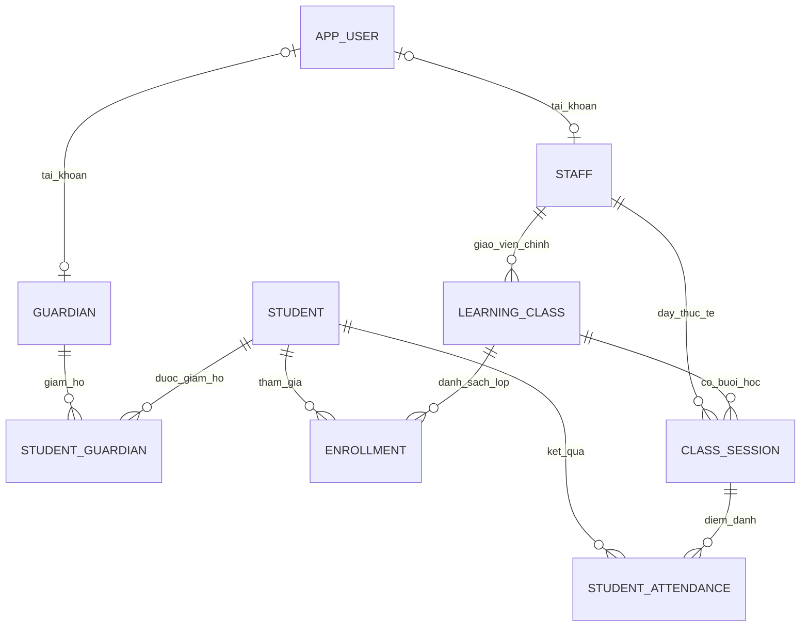
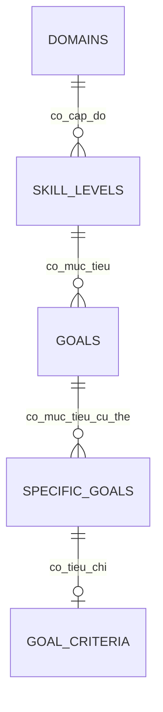
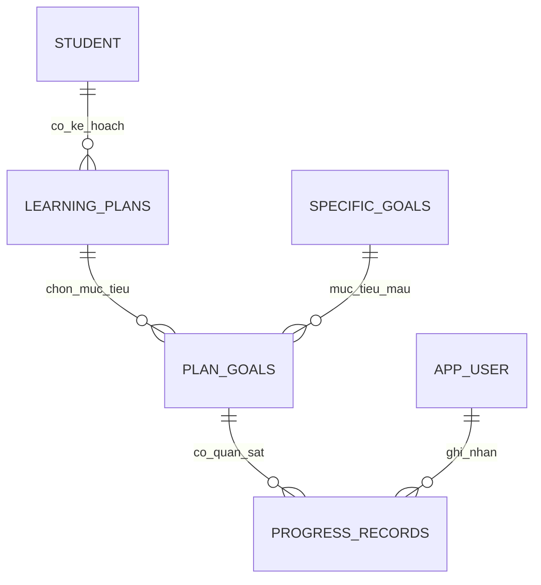

# THIẾT KẾ DATABASE — TRUNG TÂM DƯƠNG AN

> **Bản điều chỉnh 1.1 · 26/10/2026**  
> **Trạng thái:** Tài liệu thiết kế đã cập nhật theo yêu cầu, **chưa phải SQL migration đã triển khai**.  
> **Định hướng:** Một trung tâm duy nhất · Lớp/lịch học đơn giản · Ngân hàng mục tiêu và theo dõi tiến độ trẻ.

## 1. Tổng quan nhanh

| Hạng mục | Thiết kế đã thống nhất |
| --- | --- |
| Mô hình tổ chức | **Một trung tâm**; không có chi nhánh/cơ sở trực thuộc |
| Người dùng | `ADMIN`, `TEACHER`, `PARENT` |
| Lớp và lịch học | **4 bảng**: `learning_class`, `enrollment`, `class_session`, `student_attendance` |
| Ngân hàng mục tiêu mẫu | **5 bảng**: `domains`, `skill_levels`, `goals`, `specific_goals`, `goal_criteria` |
| Kế hoạch & tiến độ trẻ | **3 bảng**: `learning_plans`, `plan_goals`, `progress_records` |
| Hồ sơ trẻ | Dùng **`student` sẵn có**, **không tạo `children`** trùng dữ liệu |
| Quy mô thiết kế đề xuất | **28 bảng** (20 bảng nền tảng và vận hành + 8 bảng mục tiêu/kế hoạch); `invoice_balance` là một view, không tính là bảng |
| Cơ sở dữ liệu dự kiến | PostgreSQL; cấu hình Java/MySQL hiện tại cần được thay đổi riêng khi triển khai |

**Nguyên tắc chính:** Giữ các nghiệp vụ khác của thiết kế gốc (tài khoản, phụ huynh, nhân sự, học phí, thông báo, tài liệu và nhật ký thao tác), chỉ loại bỏ những thành phần được nêu là thừa và những bảng phụ thuộc trực tiếp vào mô hình nhiều cơ sở/lịch học phức tạp.

## 2. Những thay đổi so với bản 1.0

### 2.1. Các bảng bỏ khỏi phạm vi V1.1

| Bảng cũ | Lý do / cách thay thế |
| --- | --- |
| `branch` | Trung tâm không có chi nhánh; bỏ toàn bộ `branch_id` ở các bảng liên quan |
| `student_transfer` | Không có nghiệp vụ chuyển cơ sở |
| `branch_holiday` | Không quản lý ngày nghỉ theo cơ sở; có thể bổ sung ngày nghỉ chung sau nếu cần |
| `student_case_assignment` | Chưa quản lý giáo viên phụ trách hồ sơ cá nhân; xem giáo viên qua lớp/buổi học |
| `staff_certificate` | Chưa cần lưu chứng chỉ thành các bản ghi riêng |
| `room` | Chưa cần quản lý phòng và sức chứa phòng; buổi học có thể ghi `location_note` dạng chữ |
| `class_teacher_assignment` | Giáo viên chính đặt ở `learning_class.teacher_id` |
| `session_teacher` | Giáo viên dạy thực tế đặt ở `class_session.teacher_id` |
| `session_student` | Danh sách học sinh của lớp tra qua `enrollment`; điểm danh liên kết trực tiếp học sinh và buổi học |
| `daycare_daily_log` | Chưa đưa nhật ký ăn/ngủ/bán trú vào phần quản lý buổi học tối giản |

**Giữ `center`** để lưu thông tin duy nhất của trung tâm (tên, địa chỉ, liên hệ, múi giờ). Bảng này chỉ có **tối đa 1 dòng** và **không phải bảng chi nhánh**. Không dùng `tenant_id`, `branch_id`, `from_branch_id`, `to_branch_id` trong thiết kế mới.

### 2.2. Bảng bổ sung mới

| Nhóm | Bảng | Mục đích |
| --- | --- | --- |
| Ngân hàng mục tiêu | `domains`, `skill_levels`, `goals`, `specific_goals`, `goal_criteria` | Danh mục mục tiêu mẫu và tiêu chí hoàn thành |
| Kế hoạch cá nhân | `learning_plans`, `plan_goals` | Chọn mục tiêu cho từng học sinh, giữ bản chụp nội dung khi giao |
| Theo dõi kết quả | `progress_records` | Ghi các lần quan sát, đánh giá tiến bộ của trẻ |

> **Quyết định tránh trùng dữ liệu:** `children.id` trong đề xuất ban đầu được thay bằng **`student.id`**. `learning_plans.child_id` đổi tên thành **`learning_plans.student_id`**. Các trường cần thiết như `admitted_on`, `withdrawn_on`, `notes` được thêm vào `student` nếu chưa có.

## 3. Sơ đồ quan hệ — chia thành 3 phần dễ đọc

### 3.1. Hồ sơ, giáo viên, lớp, buổi học và điểm danh

**Luồng cơ bản:** `staff` → `learning_class` → `class_session`; `student` → `enrollment` → lớp; `student_attendance` nối trực tiếp `student` và `class_session`.

### 3.2. Ngân hàng mục tiêu mẫu (5 bảng)

**Ví dụ mã:** Lĩnh vực Ngôn ngữ tiếp nhận → `LV1` → `ES.1.LV1.1` → `ES.1.LV1.1A` → tiêu chí đánh giá.

### 3.3. Mục tiêu cá nhân và tiến độ (3 bảng mới + `student`)

Khi thêm mục tiêu vào kế hoạch, hệ thống lưu **bản chụp `goal_snapshot` và `criteria_snapshot`** để việc chỉnh sửa ngân hàng mẫu về sau không âm thầm thay tiêu chí đang áp dụng cho trẻ.

## 4. Danh mục bảng — tổ chức, lớp học và nghiệp vụ giữ lại

### 4.1. Tổ chức, đăng nhập, học sinh và người giám hộ (7 bảng)

| Bảng | Các trường chính / chức năng | Quan hệ |
| --- | --- | --- |
| `center` | `id`, `name`, `address`, `phone`, `timezone` | Thông tin một trung tâm; tối đa một dòng |
| `app_user` | `id`, `email`, `password_hash`, `role`, `status`, `token_version` | Tài khoản ADMIN/TEACHER/PARENT; email duy nhất |
| `staff` | `id`, `code`, `full_name`, `position`, `joined_on`, `left_on`, `user_id` | `user_id` tùy chọn → `app_user.id`; **không có `branch_id`** |
| `guardian` | `id`, `full_name`, `phone`, `email`, `user_id` | `user_id` tùy chọn → `app_user.id` |
| `student` | `id`, `code`, `full_name`, `birth_date`, `admitted_on`, `withdrawn_on`, `status`, `notes`, `created_at`, `updated_at` | Hồ sơ trẻ; dùng chung cho lớp học, học phí, kế hoạch |
| `student_guardian` | `student_id`, `guardian_id`, `relationship`, `can_view_portal`, `is_primary`, `revoked_at` | N–N giữa trẻ và người giám hộ |
| `staff_salary` | `id`, `staff_id`, `base_salary`, `effective_from`, `effective_to` | Lịch sử lương; khoảng hiệu lực không chồng lấn |

**Lưu ý:** Một trẻ có thể có nhiều người giám hộ, một người giám hộ có thể quản lý nhiều trẻ. Không gom về một `parent_id` duy nhất trong bảng học sinh.

### 4.2. Lớp, lịch học và điểm danh (chỉ 4 bảng)

| Bảng | Các trường chính đề xuất | Chức năng |
| --- | --- | --- |
| **`learning_class`** | `id`, `code`, `name`, `class_type`, `teacher_id`, `capacity`, `starts_on`, `ends_on`, `status` | Lớp nào, giáo viên chính nào phụ trách (`teacher_id → staff.id`) |
| **`enrollment`** | `id`, `class_id`, `student_id`, `started_on`, `ended_on`, `status` | Học sinh nào thuộc lớp; giữ lịch sử vào/ra lớp |
| **`class_session`** | `id`, `class_id`, `teacher_id`, `starts_at`, `ends_at`, `status`, `location_note` | Lịch buổi học; lưu giáo viên thực tế từng buổi (có thể khác giáo viên chính) |
| **`student_attendance`** | `id`, `session_id`, `student_id`, `status`, `marked_at`, `recorded_by`, `notes` | Điểm danh học sinh trong từng buổi; một học sinh chỉ có một kết quả/buổi |

Quy ước trong phiên bản đơn giản: **mỗi lớp có một giáo viên chính tại một thời điểm** (`learning_class.teacher_id`). Giáo viên dạy thay có thể được chọn trực tiếp trên `class_session.teacher_id`; không cần bảng riêng. Nếu sau này có **nhiều giáo viên đồng giảng dạy một lớp/buổi**, khi đó mới cần bảng nối.

**Cách lấy danh sách học sinh:** Từ `enrollment` theo `class_id` và khoảng ngày ghi danh. **Điểm danh:** Chọn `class_session`, lấy danh sách học sinh hợp lệ rồi lưu từng kết quả vào `student_attendance`. Không có kết quả điểm danh nghĩa là **chưa điểm danh**, không phải vắng.

**Trạng thái điểm danh:** `PRESENT`, `ABSENT`, `EXCUSED`, `LATE`. Mặc định chỉ điểm danh học sinh ghi danh hợp lệ vào lớp tại ngày buổi học; Spring Boot phải kiểm tra điều này trước khi ghi.

### 4.3. Nhân sự, học phí, thông báo và tiện ích (9 bảng giữ lại)

| Bảng | Nội dung | Ghi chú |
| --- | --- | --- |
| `staff_checkin` | Chấm công nhân viên theo ngày | Một bản ghi/nhân viên/ngày trong V1.1 |
| `leave_request` | Đơn nghỉ phép, trạng thái và người duyệt | Người gửi không tự duyệt |
| `invoice` | Phiếu học phí của `student` | Trạng thái `DRAFT`, `ISSUED`, `VOID` |
| `invoice_line` | Dòng thu, số lượng, đơn giá, giảm trừ | Thuộc `invoice` |
| `payment` | Các lần thanh toán một phiếu | Cho phép nhiều lần thu; chống request trùng |
| `notification` | Nội dung thông báo | Phạm vi toàn trung tâm, **không còn `branch_id`** |
| `notification_recipient` | Tài khoản nhận và thời gian đọc | N–N thông báo/tài khoản |
| `document` | File/đường dẫn tài liệu | Tài liệu chung trung tâm; **không còn `branch_id`** |
| `audit_event` | Nhật ký ai thao tác, thời điểm và đối tượng | Không tự phát sinh nếu backend chưa ghi |

`invoice_balance` tiếp tục là **view** tính tổng phải thu, tổng đã thanh toán và số tiền còn nợ. Không tạo bảng tổng tiền dễ lệch dữ liệu.

## 5. Ngân hàng mục tiêu (5 bảng mới)

| Bảng | Trường dữ liệu chính | Vai trò |
| --- | --- | --- |
| **`programs`** | `id`, `code`, `name`, `age_min_months`, `age_max_months`, `description` | Chương trình can thiệp theo độ tuổi, ví dụ **Denver** |
| **`domains`** | `id`, `program_id`, `code`, `name`, `description` | Lĩnh vực thuộc chương trình, ví dụ **Ngôn ngữ tiếp nhận**; `program_id` tham chiếu `programs.id` |
| **`skill_levels`** | `id`, `domain_id`, `code`, `name` | Cấp độ trong lĩnh vực, ví dụ `LV1`, `LV2` |
| **`goals`** | `id`, `skill_level_id`, `code`, `name`, `age_min_months`, `age_max_months` | Mục tiêu tổng quát, ví dụ `ES.1.LV1.1` |
| **`specific_goals`** | `id`, `goal_id`, `code`, `description`, `expected_behavior`, `display_order` | Mục tiêu cụ thể, ví dụ `ES.1.LV1.1A` |
| **`goal_criteria`** | Xem bảng chi tiết bên dưới | Bộ điều kiện đạt của **một mục tiêu cụ thể** |

### 5.1. Chi tiết `goal_criteria`

| Nhóm | Cột | Ý nghĩa |
| --- | --- | --- |
| Khóa | `id`, `specific_goal_id` | Khóa chính và FK; **`UNIQUE(specific_goal_id)`** để mỗi mục tiêu có tối đa một bộ tiêu chí |
| Cách đo | `measurement_type` | Kiểu đo: số lần, cơ hội đúng/tổng cơ hội, tỷ lệ %, thời lượng… |
| Số lần | `target_count` | Số lần đạt yêu cầu |
| Thời gian | `observation_minutes` | Số phút trong một lần quan sát |
| Cơ hội | `successful_opportunities`, `total_opportunities` | Ngưỡng đúng / tổng số cơ hội |
| Tỷ lệ | `target_percentage` | Tỷ lệ hoàn thành tối thiểu (0–100) |
| Hỗ trợ | `support_level` | Mức hỗ trợ của người lớn |
| Tính ổn định | `required_periods`, `period_unit`, `must_be_consecutive` | Ví dụ **3 ngày liên tiếp** |
| Bối cảnh | `adult_count`, `setting_count` | Số người lớn và số bối cảnh cần thực hiện |

**Quan hệ:** `domains` **1–N** `skill_levels` **1–N** `goals` **1–N** `specific_goals` **1–0..1** `goal_criteria`.

**Ràng buộc đề xuất:** Mã mục tiêu duy nhất; `display_order` không âm; số lần/số cơ hội/số phút không âm; tỷ lệ trong `[0,100]`; nếu khai báo cả số cơ hội đúng và tổng cơ hội thì số đúng không vượt tổng. Backend xác định những trường bắt buộc tùy `measurement_type` thay vì yêu cầu tất cả các trường cho mọi mục tiêu.

### 5.2. Ví dụ dữ liệu mục tiêu

| Cấp | Mã | Nội dung ví dụ |
| --- | --- | --- |
| Lĩnh vực | `ES.1` | Ngôn ngữ tiếp nhận |
| Cấp độ | `LV1` | Cấp độ 1 |
| Mục tiêu tổng quát | `ES.1.LV1.1` | Định vị nguồn phát âm thanh bằng cách quay đầu về hướng phát ra âm thanh |
| Mục tiêu cụ thể | `ES.1.LV1.1A` | Quay đầu về nguồn âm thanh từ đồ chơi/đồ vật |
| Tiêu chí mẫu | — | 1 lần trong 30 phút; 3 ngày liên tiếp; với cô và một người lớn khác; ở nhà và lớp |

*Ví dụ chỉ minh họa cấu trúc theo mục tiêu bạn đã nêu, không phải dữ liệu đã nhập vào hệ thống. Khoảng tuổi, mức hỗ trợ và những chi tiết chưa chỉ rõ cần nhập theo bộ mục tiêu được duyệt.*

## 6. Kế hoạch học tập và theo dõi tiến độ từng trẻ (3 bảng mới)

| Bảng | Trường dữ liệu chính | Vai trò |
| --- | --- | --- |
| **`learning_plans`** | `id`, **`student_id`**, `name`, `start_date`, `end_date`, `status` | Kế hoạch của một học sinh (`student.id`) |
| **`plan_goals`** | `id`, `plan_id`, `specific_goal_id`, `goal_snapshot`, `criteria_snapshot`, `status`, `assigned_at` | Mục tiêu cụ thể được chọn và bộ tiêu chí *chụp tại thời điểm giao* |
| **`progress_records`** | `id`, `plan_goal_id`, `observed_at`, `session_key`, `success_count`, `opportunity_count`, `observation_minutes`, `support_level`, `partner_reference`, `setting`, `notes`, `recorded_by` | Một lần theo dõi kết quả/quan sát của trẻ |

**Chú thích trường:**

- `goal_snapshot` và `criteria_snapshot` nên là `jsonb`; nội dung của lần giao mục tiêu đã được chốt, không tự cập nhật khi sửa mẫu.
- `plan_goals.status`: gợi ý `NOT_STARTED`, `IN_PROGRESS`, `ACHIEVED`, `PAUSED`. Chỉ ghi đạt khi dữ liệu quan sát thỏa bộ tiêu chí của chính mục tiêu trong kế hoạch.
- `progress_records.recorded_by` là FK đến `app_user.id` của người nhập. `session_key` là mã tham chiếu buổi quan sát do nghiệp vụ quy ước; **chưa phải khóa ngoại** đến `class_session`. Khi tích hợp chặt lịch học, có thể bổ sung `class_session_id` nullable để làm FK.
- `partner_reference` cần nhận diện nhất quán người hỗ trợ nếu muốn tính **số người lớn khác nhau**; `setting` cần dùng danh mục giá trị nhất quán (ví dụ `HOME`, `CLASSROOM`) nếu muốn tính số bối cảnh.
- Việc tổng hợp các quan sát theo ngày/tuần và điều kiện *liên tiếp* nằm ở service; **không thể suy ra đạt chỉ từ một dòng quan sát** nếu tiêu chí yêu cầu nhiều ngày, nhiều người hoặc nhiều bối cảnh.

### 6.1. Luồng sử dụng

1. Admin/giáo viên được cấp quyền chọn học sinh trong `student` và tạo `learning_plans`.
2. Chọn một hoặc nhiều `specific_goals` từ ngân hàng; ghi vào `plan_goals` và chụp lại tiêu chí.
3. Trong mỗi lần quan sát, giáo viên ghi `progress_records` (thành công, cơ hội, thời gian, hỗ trợ, bối cảnh…).
4. Hệ thống đối chiếu lịch sử quan sát với `criteria_snapshot`, hiển thị tiến độ và đề xuất trạng thái đạt/chưa đạt.
5. Khi chỉnh sửa mục tiêu mẫu, kế hoạch đã giao **không đổi tiêu chí âm thầm**; muốn áp dụng tiêu chí mới phải thực hiện thao tác cập nhật có lưu lịch sử.

## 7. Những quan hệ và ràng buộc quan trọng

| Quan hệ / nguyên tắc | Quy tắc |
| --- | --- |
| Giáo viên → Lớp | `learning_class.teacher_id → staff.id`; một giáo viên có thể phụ trách nhiều lớp |
| Lớp → Học sinh | `enrollment.class_id → learning_class.id`, `enrollment.student_id → student.id` |
| Lớp → Buổi học | `class_session.class_id → learning_class.id`; `class_session.teacher_id → staff.id` lưu người dạy thực tế |
| Buổi học → Điểm danh | `student_attendance.session_id → class_session.id`, `student_attendance.student_id → student.id`; **UNIQUE(session_id, student_id)** |
| Học sinh → Kế hoạch | `learning_plans.student_id → student.id`; một học sinh có thể có nhiều kế hoạch |
| Kế hoạch → Mục tiêu | `plan_goals.plan_id → learning_plans.id`; `specific_goal_id → specific_goals.id` |
| Mục tiêu giao → Tiến độ | `progress_records.plan_goal_id → plan_goals.id`; một mục tiêu có nhiều lần quan sát |
| Mẫu mục tiêu → Tiêu chí | `goal_criteria.specific_goal_id` là **FK + UNIQUE**, cho phép mục tiêu chưa có tiêu chí |
| Chống trùng lịch | Nên chặn trùng thời gian **cùng lớp** và **cùng giáo viên** ở DB; kiểm tra trùng lịch học sinh từ `enrollment` ở **service** |
| Bảo toàn lịch sử | Dừng ghi danh, khóa tài khoản, hủy buổi, kết thúc kế hoạch bằng trạng thái; không cascade xóa học phí, điểm danh, tiến độ |

**Quan trọng về độ đơn giản:** Sau khi bỏ `session_student`, DB **không thể tự đảm bảo** người được điểm danh đang ghi danh trong lớp ở đúng ngày; Spring Boot phải kiểm tra. Cũng không thể đảm bảo mọi học sinh không trùng lịch chỉ bằng FK. Đây là đánh đổi có chủ đích để giảm số bảng.

## 8. Phân quyền theo 3 vai trò

| Chức năng | ADMIN | TEACHER | PARENT |
| --- | --- | --- | --- |
| Hồ sơ học sinh | Toàn trung tâm | Trẻ trong lớp/buổi được phân công | Chỉ trẻ liên kết và còn quyền |
| Lớp và lịch học | Tạo, sửa, xếp lịch | Xem lớp/buổi phụ trách | Xem lịch của con |
| Điểm danh | Quản lý | Ghi/sửa theo quy định tại buổi được phân công | Chỉ xem con |
| Ngân hàng mục tiêu | Quản trị | Xem và chọn mục tiêu | Không sửa mẫu |
| Kế hoạch & tiến độ | Xem/quản lý | Lập và ghi nhận cho trẻ được phân công | **Chưa tự động mở quyền xem**; cần duyệt chính sách công bố |
| Học phí và phiếu thu | Quản lý | Không | Xem phiếu của con nếu được cấp quyền |
| Nhân sự/lương | Quản lý | Chỉ dữ liệu của chính mình theo chính sách | Không |

**Không kiểm tra quyền chỉ ở frontend.** API phải xác định học sinh/lớp/buổi nào thuộc phạm vi của tài khoản đăng nhập. Quyền xem kế hoạch và tiến độ của phụ huynh là **quyết định nghiệp vụ chưa chốt**, không mặc định trả dữ liệu riêng tư.

## 9. Ánh xạ frontend và các lưu ý triển khai Spring Boot

| Dữ liệu cũ / màn hình | Cách dùng trong thiết kế mới |
| --- | --- |
| `Student.parentId`, `Parent.studentIds[]` | `student_guardian`; không lưu mảng ID trong DB |
| `Student.teacherId` | **Không còn giáo viên phụ trách hồ sơ riêng**; lấy giáo viên theo lớp học/ghi danh hoặc buổi cụ thể |
| `SchoolClass.teacherId` | `learning_class.teacher_id` |
| `SchoolClass.studentIds[]` | Tra qua `enrollment` |
| `Session.date/start/end` | `class_session.starts_at`, `ends_at` dạng `timestamptz` |
| `Session.room` | `class_session.location_note` (chuỗi tùy chọn), không có `room` |
| `Session.attendance` | `student_attendance` với khóa duy nhất theo `(session_id, student_id)` |
| `Staff.certificate` | Chưa có bảng/chức năng chứng chỉ riêng |
| `Staff.salary` | `staff_salary` lưu lịch sử mức lương |
| Hồ sơ mục tiêu của trẻ | `student` → `learning_plans` → `plan_goals` → `progress_records` |

- Dùng PostgreSQL, Flyway và `spring.jpa.hibernate.ddl-auto=validate` khi **có migration thực tế**; không mô tả tài liệu này như SQL đã chạy.
- `id` nghiệp vụ dùng UUID; email và mã hiển thị cần ràng buộc duy nhất thích hợp. Lưu tiền VND bằng `numeric(...,0)`, thời điểm quan sát bằng `timestamptz`, ngày bằng `date`.
- Khi tạo điểm danh: kiểm tra `student` có `enrollment` hợp lệ tại buổi đó, buổi chưa hủy, giáo viên đúng buổi; dữ liệu điểm danh cũ không bị mất khi trẻ nghỉ lớp.
- Khi tạo lịch: kiểm tra xung đột lớp/giáo viên trong transaction. Với học sinh, đối chiếu lịch của các lớp đang ghi danh ở service. Nếu cần bảo đảm tuyệt đối trước race condition, phải bổ sung khóa/thiết kế phù hợp.
- Khi lưu tiến độ: xác thực quyền giáo viên, kiểm tra `plan_goal` thuộc đúng học sinh và kế hoạch, `success_count ≤ opportunity_count` khi cả hai có giá trị; không lấy `recorded_by` từ payload do client tùy ý gửi.
- Các giao dịch học phí cần khóa phiếu và chống ghi thu trùng như thiết kế 1.0. Không sử dụng `CascadeType.REMOVE` từ hồ sơ trẻ tới điểm danh/học phí/tiến độ.
- PostgreSQL là **đề xuất**; bản Java đang dùng MySQL cần điều chỉnh driver/Compose trước khi chạy migration PostgreSQL. Chưa thực hiện thay đổi môi trường trong tài liệu này.

## 10. Các quyết định mặc định và phần để sau

| Nội dung | Quyết định hiện tại |
| --- | --- |
| Nhiều cơ sở / chuyển cơ sở | **Bỏ hoàn toàn trong V1.1** |
| Nhiều giáo viên trên một lớp/buổi | **Chưa hỗ trợ** bằng bảng nối; 1 giáo viên chính/lớp và 1 người dạy thực tế/buổi |
| Phòng học, chống trùng phòng | **Chưa quản lý**; có ghi chú địa điểm nếu cần |
| Bán trú, ghi ăn/ngủ | **Chưa có** bảng `daycare_daily_log`; bổ sung sau nếu nghiệp vụ phát sinh |
| Các dịp nghỉ/lễ chung | Chưa có bảng ngày nghỉ; có thể thêm `center_holiday` nếu cần lập lịch tự động |
| Đánh giá đa cấp và báo cáo chuyên sâu | Chưa bổ sung bảng review/duyệt/công bố; ưu tiên ngân hàng mục tiêu và ghi tiến độ |
| Điều kiện đạt mục tiêu | Dữ liệu mẫu ghi trong `goal_criteria`; thuật toán tổng hợp thời gian, đối tác, bối cảnh **cần được hiện thực ở service** |
| Sửa/xóa mục tiêu mẫu đã sử dụng | Chỉ vô hiệu hóa hoặc phiên bản hóa; không xóa làm mất tham chiếu; kế hoạch giữ snapshot |
| Phạm vi cha mẹ xem kế hoạch | Cần chốt riêng trước khi mở API |

**Kết luận:** V1.1 ưu tiên **dễ làm, dễ đọc, đủ cho các nghiệp vụ lớp–buổi học–điểm danh và can thiệp theo mục tiêu**. Các bảng thuộc chi nhánh và lịch học nâng cao không còn trong sơ đồ thiết kế. Những bảng mục tiêu vừa bổ sung đã được đặt vào **phạm vi V1.1**, không còn chỉ là dự định ở giai đoạn 2.
