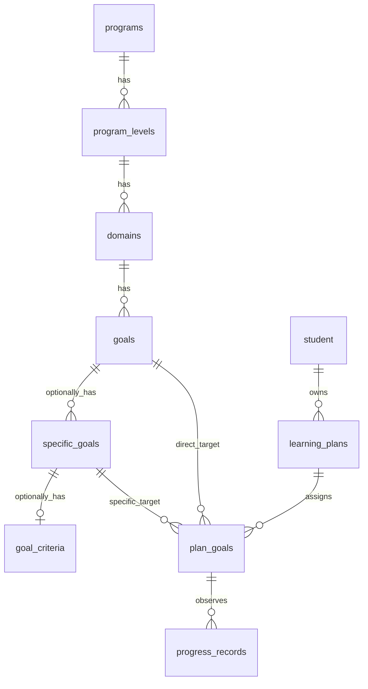

# Ngân hàng mục tiêu chung — MySQL V5

> Bản thiết kế này là bước trung gian UUID và được giữ để tham khảo lịch sử. Ngày 27/10/2026 đã áp dụng V5 → V6 lên cả MySQL local 3306 và Docker 3308, schema `duong_an_v11`. Thiết kế đang dùng là [V6](GOAL_BANK_V6.md): ID `VARCHAR(8)`, `plan_goals.goal_id` bắt buộc. Không dùng quy tắc “chính xác một FK” của V5 làm hợp đồng API hiện tại.

Dự án hiện chạy MySQL 8.4 trong Docker và Spring Boot dùng JDBC. Chưa có JPA hoặc Flyway. PostgreSQL trong bản yêu cầu là định hướng khác; theo lựa chọn hiện tại, migration dưới đây viết cho MySQL và **không đổi kết nối**.

## Phân tích schema cũ

V1 tạo `domains → skill_levels → goals → specific_goals → goal_criteria`. V4 bổ sung `programs → domains`. Vì thế cấp độ đang nằm *sau* lĩnh vực, trái với dữ liệu Denver/VB. `goals` trước đây không có mô tả riêng; `specific_goals` bị bắt buộc trong `plan_goals`, khiến mục tiêu Denver hoặc mục tiêu VB không có con không thể giao trực tiếp. V2 có trigger tạo snapshot và khóa bản đã giao; `progress_records` tham chiếu `plan_goals`. Frontend cũ dùng thư viện minh họa trong LocalStorage, không đọc SQL. Backend cũ chưa có API thư viện, JPA Entity hoặc JPA Repository.

Trước khi viết V5, MySQL đang chạy có **0** bản ghi trong `programs`, `domains`, `skill_levels`, `goals`, `specific_goals`, `goal_criteria`, `plan_goals` và `progress_records`. Dữ liệu hồ sơ và kế hoạch hiện hữu không bị migration xóa. V5 chủ động dừng ngay nếu phát hiện dữ liệu ngân hàng hoặc bản giao cũ; muốn chuyển dữ liệu đó cần bảng đối chiếu chương trình/cấp độ từ tài liệu nguồn.

| Bảng | Xử lý |
| --- | --- |
| `programs` | Giữ, chuyển tuổi áp dụng xuống từng `program_levels`; giữ mã duy nhất toàn hệ thống. |
| `program_levels` | Tạo mới; tuổi, thứ tự hiển thị và `level_number` riêng từng chương trình. |
| `domains` | Chuyển FK từ `programs` sang `program_levels`; mã chỉ duy nhất trong một cấp độ. |
| `goals` | Chuyển FK từ `skill_levels` sang `domains`; tên và mô tả cùng bản ghi; mã chỉ duy nhất trong một lĩnh vực. |
| `specific_goals` | Giữ; thêm tuổi riêng tùy chọn; mã chỉ duy nhất trong một mục tiêu cha. |
| `skill_levels` | Bỏ cấu trúc cũ **chỉ khi tất cả dữ liệu ngân hàng trống**; V5 từ chối chạy nếu không trống. |
| `goal_criteria` | Giữ cho tiêu chí của mục tiêu cụ thể. Mục tiêu tổng quát được phép chưa có tiêu chí. |
| `learning_plans`, `progress_records` | Giữ nguyên. |
| `plan_goals` | Giữ lịch sử, thêm FK `goal_id`; một bản giao chọn chính xác một trong `goal_id` hoặc `specific_goal_id`. Snapshot v2 ghi nguyên nội dung tại thời điểm giao. |



`plan_goals` dùng `CHECK` để yêu cầu đúng một loại mục tiêu. Khóa duy nhất trên mục tiêu gốc của từng kế hoạch chặn giao trùng ngoài ý muốn và vẫn cho phép tạo phiên bản thay thế thông qua `supersedes_id`. FK không dùng cascade delete; mục tiêu đã giao giữ snapshot dù thư viện sửa nội dung. Tuổi NULL của mục tiêu cụ thể được lấy từ cấp độ khi API đọc.

## Áp dụng và kiểm thử

Docker chỉ chạy các file `docker-entrypoint-initdb.d` khi tạo volume trống. Việc thêm V5 vào `compose.yaml` **không tự nâng cấp volume MySQL hiện tại**. V5 có thao tác đổi cột và bỏ bảng `skill_levels` cũ; không chạy trực tiếp trên database đang sử dụng trước khi kiểm tra backup, ngừng ghi và xác nhận dữ liệu ngân hàng vẫn rỗng. Nếu một bản ghi đã xuất hiện, migration sẽ dừng trước DDL và cần phương án chuyển dữ liệu riêng.

Kiểm thử an toàn trên database tạm, tự xóa sau khi chạy:

```powershell
docker compose up -d
powershell -ExecutionPolicy Bypass -File database/mysql/test_goal_bank.ps1
```

Đã kiểm tra V1→V5 trên database riêng; 15 bài kiểm thử backend chạy qua. Kiểm tra guard riêng xác nhận V5 từ chối database có chương trình cũ và giữ nguyên dữ liệu/bảng cũ. File migration: [V5__goal_bank_hierarchy.sql](migrations/V5__goal_bank_hierarchy.sql).

Để áp dụng cho volume hiện hữu, trước hết sao lưu toàn bộ `duong_an_v11`, tạm ngừng ghi, rồi xác nhận tám bảng `programs`, `domains`, `skill_levels`, `goals`, `specific_goals`, `goal_criteria`, `plan_goals`, `progress_records` vẫn rỗng. Sau đó dùng MySQL Workbench mở và chạy V5 trên schema `duong_an_v11` đúng một lần; kiểm tra có `program_levels`, không còn `skill_levels`, và khởi động lại Spring Boot. Không chạy lại V1–V4 trên volume hiện hữu. Nếu guard báo lỗi, dừng lại để lập phương án chuyển dữ liệu từ nguồn thật; không xóa dữ liệu để ép migration chạy.

## API và giao diện

Các API đọc chung cho Denver/VB, yêu cầu phiên đăng nhập:

| API | Kết quả |
| --- | --- |
| `GET /api/programs` | Chương trình đang hoạt động. |
| `GET /api/programs/{id}/levels` | Cấp độ, sắp theo `display_order`, ID. |
| `GET /api/levels/{id}/domains` | Lĩnh vực, sắp theo `display_order`, ID. |
| `GET /api/domains/{id}/goals?q=&page=0&size=20` | Mục tiêu có tìm kiếm và phân trang; `size` từ 1 đến 100. |
| `GET /api/goals/{id}` | Chi tiết, `description` có thể NULL và `specificGoals` luôn là mảng. |

ADMIN có thêm `POST /api/domains/{id}/goals`, `GET/POST /api/students`, `GET/POST /api/students/{id}/plans`, `GET/POST /api/plans/{id}/goals`. POST dùng CSRF token của `/api/auth/csrf`. Mã mục tiêu trùng trong cùng lĩnh vực trả 409; UUID/tham số sai trả 400; ID không tồn tại trả 404. Giao diện kế hoạch mới dùng các API này cho học sinh, kế hoạch, chương trình, cấp độ, lĩnh vực, mục tiêu và bản giao. Phạm vi sửa kế hoạch hiện giới hạn ở ADMIN vì quy tắc phân công giáo viên chưa có API tương ứng.

## Import dữ liệu nguồn

Workspace chưa có Excel Denver hoặc tài liệu VB; không nhập hoặc tự viết nội dung chuyên môn giả. Khi có nguồn, cần đối chiếu cột trước khi viết bộ đọc định dạng:

- Denver: mã chương trình → số/tên/tuổi cấp độ → mã/tên lĩnh vực → mã kỹ năng, **tên kỹ năng** vào `goals.name`, **mô tả nguyên văn** vào `goals.description`. Không tạo `specific_goals` từ mô tả Denver.
- VB: mục tiêu tổng quát vào `goals`; các mã A/B/C… có thật trong nguồn vào `specific_goals`, giữ nguyên nội dung và tuổi riêng nếu có. Mục tiêu không có con vẫn được giữ.
- Trước khi ghi, kiểm tra thiếu mã, trùng mã trong phạm vi cha, tuổi sai, FK sai và thứ tự cấp độ. Báo cáo dòng lỗi. Tra cứu theo mã trong phạm vi cha để chạy lại mà không tạo bản ghi trùng. Nội dung đã giao trong `plan_goals` không được cập nhật theo bản import mới.

Nếu sau này chọn PostgreSQL, cần chuyển **toàn bộ** 28+ bảng MySQL, kiểu `CHAR(36)` sang UUID, `DATETIME(6)` sang `timestamptz`/UTC phù hợp, JSON sang JSONB, generated columns, trigger/procedure, `INSERT IGNORE`, chỉ mục và cấu hình JDBC. Phải xuất/kiểm kê dữ liệu thật, import vào PostgreSQL thử nghiệm, đối chiếu số lượng/FK/snapshot, rồi mới chuyển kết nối. Không chạy file V5 MySQL trên PostgreSQL và không dùng `ddl-auto=update` để thay migration.
