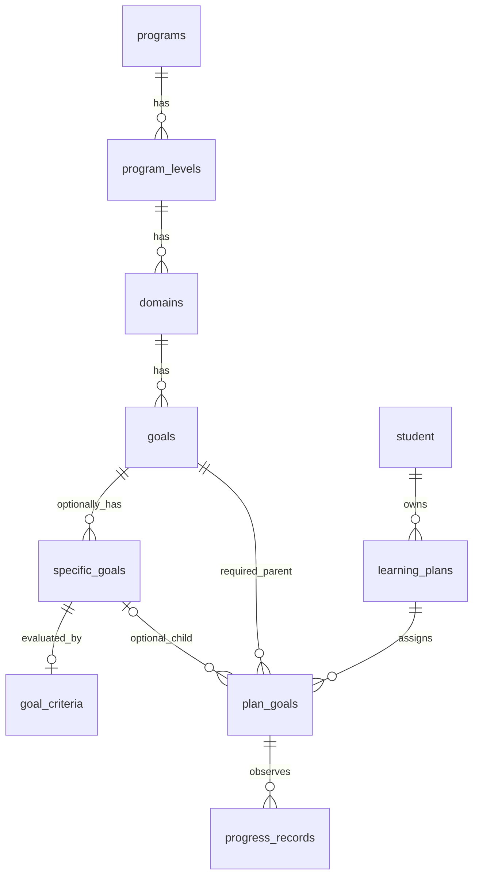

# Ngân hàng mục tiêu MySQL V6 — ID ngắn, mục tiêu cha bắt buộc

**Bổ sung sau V6:** [Luồng ngân hàng theo học sinh V7](GOAL_BANK_FLOW.md) đã triển khai và áp dụng trên local 3306/Docker 3308. Tài liệu V7 mô tả quy tắc Denver không truy vấn con, VB chọn con hoặc chính khi không có con, API xem lại/hoàn tất, dữ liệu đã nhập và kiểm thử mới nhất. Các kết quả và giới hạn dưới đây ghi nhận thời điểm nâng cấp V6.

## Trạng thái và phạm vi

Ngày cập nhật: 27/10/2026. Sau khi người dùng xác nhận áp dụng, **đã chạy V5 → V6 thành công trên cả MySQL local 9.1.0 ở `127.0.0.1:3306` và MySQL Docker 8.4.13 ở `127.0.0.1:3308`**, cùng schema `duong_an_v11`. Local 3306 trước đó chưa có schema dự án nên được tạo từ full backup Docker, rồi nâng cấp; các database local khác không bị thay đổi. Volume Docker hiện hữu được nâng cấp và giữ dữ liệu. Không nhập mục tiêu giả hoặc nội dung chuyên môn chưa có nguồn.

Backend vẫn mặc định kết nối Docker 3308. Hai server là hai bản database độc lập, không tự đồng bộ dữ liệu phát sinh. Muốn backend dùng local 3306, cấu hình `DB_URL` trỏ tới `jdbc:mysql://127.0.0.1:3306/duong_an_v11?useUnicode=true&characterEncoding=utf8&serverTimezone=UTC`. Các database `goalbank_test_*` chỉ phục vụ kiểm thử và được xóa khi script kết thúc.

Backend hiện dùng Spring Boot MVC, JDBC, các lớp Controller → Service → Repository và DTO. Không có JPA Entity, Hibernate, Flyway hoặc Liquibase để cập nhật; không bổ sung ORM hay thay kiến trúc. Giữ nguyên V1–V5; thay đổi mới nằm trong [V6__catalog_short_ids.sql](migrations/V6__catalog_short_ids.sql).

Trước khi chuẩn bị migration, đã kiểm tra schema và toàn bộ FK tham chiếu ngân hàng mục tiêu. Các bảng `programs`, `domains`, `skill_levels`, `goals`, `specific_goals`, `goal_criteria`, `plan_goals`, `progress_records` đều rỗng. V5 từ chối chạy nếu xuất hiện dữ liệu ở bất kỳ bảng nào trong nhóm này: không tự suy đoán chương trình/cấp độ cho dữ liệu V4. Dùng [preflight_goal_bank.sql](preflight_goal_bank.sql) để lấy danh sách ID, quan hệ và các bản ghi cần ánh xạ thủ công nếu dữ liệu thay đổi.

## Các bảng trước và sau

| Bảng trước V4 | Sau V5 → V6 |
| --- | --- |
| `programs` | Giữ; ID `VARCHAR(8)`, dạng `PR0001`; tuổi chuyển xuống cấp độ, tên tối đa 255 ký tự. |
| Chưa có `program_levels` | Tạo theo V5; ID `LV0001`, FK `program_id VARCHAR(8)`; UNIQUE theo chương trình/số cấp, CHECK tuổi và thứ tự. |
| `domains.program_id` | Thay bằng `program_level_id VARCHAR(8)`; ID `DM0001`; UNIQUE theo cấp độ/mã. |
| `goals.skill_level_id` | Thay bằng `domain_id VARCHAR(8)`; ID `GL000001`; `name TEXT` và `description TEXT` cùng bảng; UNIQUE theo lĩnh vực/mã. |
| `specific_goals` | ID `SG000001`, FK `goal_id VARCHAR(8)`; tuổi riêng nullable, UNIQUE theo mục tiêu cha/mã. |
| `skill_levels` | V5 bỏ cấu trúc cũ sau khi xác nhận ngân hàng trống. Nếu có dữ liệu, dừng để lập ánh xạ trước khi tiếp tục. |
| `goal_criteria` | Giữ bảng và dữ liệu; chỉ đổi FK `specific_goal_id` thành `VARCHAR(8)`. |
| `plan_goals` | Giữ ID UUID riêng; `goal_id VARCHAR(8) NOT NULL`, `specific_goal_id VARCHAR(8) NULL`; thêm FK ghép bảo đảm mục tiêu con thuộc đúng cha. |
| `learning_plans`, `progress_records` | Giữ nguyên cấu trúc, UUID và dữ liệu. |

Có đúng **5 bảng danh mục giáo dục**: `programs`, `program_levels`, `domains`, `goals`, `specific_goals`. Hai bảng kỹ thuật mới không phải tầng dữ liệu chương trình: `catalog_id_sequences` giữ bộ đếm ID; `migration_v6_catalog_ids` lưu ánh xạ UUID → ID mới để đối chiếu/khôi phục. `goal_criteria` là bảng đánh giá đã tồn tại, được giữ để không mất tiêu chí và lịch sử.

Các cột cũ bổ sung như timestamps, `domains.description/is_active`, `specific_goals.expected_behavior/is_active` được giữ để bảo toàn dữ liệu và hỗ trợ ngừng sử dụng mục tiêu. Không bỏ các cột ngoài yêu cầu khi chưa có nhu cầu.

Các bảng còn lại giữ nguyên: `app_user`, `audit_event`, `center`, `class_session`, `document`, `enrollment`, `guardian`, `invoice`, `invoice_line`, `learning_class`, `leave_request`, `notification`, `notification_recipient`, `payment`, `staff`, `staff_checkin`, `staff_salary`, `student`, `student_attendance`, `student_guardian`. View `invoice_balance` không đổi.



## ID, dữ liệu cũ và lịch sử

V6 kiểm tra schema V5, số lượng bản ghi, định dạng UUID, bảy FK dự kiến và các tham chiếu ngoài phạm vi trước khi đổi ID. Nếu có FK lạ hoặc ID chưa thể ánh xạ, migration dừng. Mỗi bảng có ánh xạ riêng, được lưu trước khi thay ID/FK. V6 không tắt `FOREIGN_KEY_CHECKS`, không xóa bảng để thay dữ liệu; dữ liệu ID được chuyển trong một transaction sau khi tháo các FK đã kiểm tra, rồi đổi kiểu và khôi phục các FK. Cần ngừng toàn bộ ứng dụng/import đang ghi trong cả quá trình.

Khi tạo dữ liệu mới, `CatalogIdGenerator` khóa hàng bộ đếm bằng `SELECT ... FOR UPDATE` trong cùng transaction với INSERT. Không dùng `MAX(id)+1`. Mỗi loại có tối đa 999.999 ID; `PR/LV/DM` bắt đầu với bốn chữ số và tăng tới sáu chữ số, `GL/SG` dùng sáu chữ số, toàn bộ tối đa tám ký tự. Khi hết dải, API trả 409. INSERT lỗi sẽ rollback cả bộ đếm. Import hoặc công cụ ghi khác phải dùng cùng cơ chế; không tự chèn ID ngoài bộ đếm.

`plan_goals` có hai dạng:

```json
{"goalId":"GL000001","specificGoalId":null}
```

```json
{"goalId":"GL000500","specificGoalId":"SG000001"}
```

FK ghép `(specific_goal_id, goal_id) → specific_goals(id, goal_id)` cùng kiểm tra Service/trigger chặn gán sai cha. Khóa duy nhất ngăn giao trùng cùng một mục tiêu gốc trong kế hoạch; chuỗi thay thế vẫn được giữ qua `supersedes_id`.

V6 bổ sung mục tiêu cha còn thiếu cho bản giao cụ thể V5 rồi chuyển các FK. JSON `goal_snapshot`/`criteria_snapshot`, metadata giao mục tiêu, trạng thái và chuỗi thay thế được giữ. Snapshot cũ vẫn có thể chứa UUID lịch sử và không được viết lại; dùng bảng ánh xạ nếu cần tra cứu ID hiện tại. Bản giao mới tạo snapshot v3. API DELETE mục tiêu dùng `is_active=0`; FK không có cascade delete và chặn xóa cứng mục tiêu đang được tham chiếu.

## API và các file Java

API đọc dùng chung Denver/VB, cho người dùng đã đăng nhập theo chính sách hiện tại:

- `GET /api/programs`
- `GET /api/programs/{id}/levels`
- `GET /api/levels/{id}/domains`
- `GET /api/domains/{id}/goals?q=&page=0&size=20`
- `GET /api/goals/{id}`

API ghi dành cho ADMIN, yêu cầu CSRF:

- `POST /api/programs`
- `POST /api/programs/{id}/levels`
- `POST /api/levels/{id}/domains`
- `POST /api/domains/{id}/goals`
- `PUT /api/goals/{id}`, `DELETE /api/goals/{id}`
- `POST /api/goals/{id}/specific-goals`
- `PUT /api/goals/{id}/specific-goals/{specificId}`, `DELETE` cùng đường dẫn
- `GET/POST /api/plans/{id}/goals`: ADMIN; POST theo hai JSON ở trên. ID kế hoạch vẫn là UUID.

DTO chi tiết giữ `description` nullable, `specificGoals` luôn là mảng. Sắp xếp `display_order,id`; goals có tìm kiếm/phân trang. Validation trả 400, không tìm thấy trả 404, trùng khóa hoặc sai tham chiếu trả 409. Nội dung TEXT được giữ nguyên, không cắt ngắn hoặc trim tên/mô tả; dữ liệu vượt dung lượng TEXT được từ chối. Tuổi NULL của mục tiêu cụ thể được kế thừa riêng từng giá trị từ cấp độ.

File Java thay đổi/tạo trong `src/main/java/com/example/TTGDHNDuongAn/`:

- `repository/CatalogIdGenerator.java`, `GoalCatalogRepository.java`, `PlanGoalRepository.java`.
- `service/GoalCatalogService.java`, `PlanGoalService.java`.
- `dto/GoalCatalogDtos.java`, `PlanGoalDtos.java`.
- `controller/GoalCatalogController.java`, `CatalogExceptionHandler.java`.
- `security/SecurityConfig.java`.

Không thay đổi Entity tài khoản, API hồ sơ, nhân sự, lớp học, học phí. Quyền giao kế hoạch hiện vẫn là ADMIN; chưa mở rộng quyền giáo viên khi chưa có cơ chế kiểm tra phân công tương ứng.

## Frontend

Các file sửa: `frontend/src/services/goalBankApi.ts`, `goalBankApi.test.ts`, `frontend/src/pages/RealInterventionPlans.tsx`, `frontend/tests/intervention.spec.ts`.

Một component cho mọi chương trình, không rẽ nhánh theo mã Denver/VB. Client gửi `goalId` bắt buộc và `specificGoalId` nullable. Khi đổi chương trình/cấp độ, xóa lựa chọn và dữ liệu phụ thuộc; phản hồi cũ bị bỏ qua. Giữ loading/error/empty state; chỉ hiện danh sách mục tiêu cụ thể khi có con và mô tả khi có nội dung.

## Backup, nâng cấp và khôi phục

Đã tạo backup đầy đủ bằng [backup_database.ps1](backup_database.ps1), bao gồm dữ liệu, trigger, procedure và view. Bản kiểm thử đầu tiên `database/.backups/duong_an_v11_before_v6_20261027_091418.sql` đã được phục hồi vào database tạm rồi nâng cấp V4 → V5 → V6 thành công.

Trước khi áp dụng thực tế, đã tạo thêm các full backup trong thư mục `database/.backups/` được Git ignore:

- `duong_an_v11_before_v6_20261027_093342.sql`: nguồn Docker dùng để tạo bản local.
- `duong_an_v11_local3306_before_v6_20261027_093342.sql`: bản local sau phục hồi, trước migration.
- `duong_an_v11_before_v6_20261027_093459.sql`: bản Docker ngay trước migration; SHA256 `877584CE32807D39A4BEBFD1C27B0955E5CF6951043B1CC594E4471CE9B14D25`.

Đã đối chiếu số bản ghi của mọi bảng cũ sau nâng cấp, ngoại trừ `skill_levels` rỗng được loại bỏ theo thiết kế; dữ liệu còn nguyên. Hash tên trung tâm khớp giữa local và Docker. Compose đã được áp dụng lại để container sử dụng mount V6; container đang `healthy`, volume giữ nguyên.

Kiểm tra chỉ đọc:

```powershell
powershell -NoProfile -ExecutionPolicy Bypass -File database/mysql/apply_goal_bank.ps1
```

**Chỉ sau khi người dùng xác nhận**, dừng backend và tất cả công cụ ghi/import, rồi chạy:

```powershell
powershell -NoProfile -ExecutionPolicy Bypass -File database/mysql/apply_goal_bank.ps1 -ApplyAfterConfirmation -WritersStopped
```

Script quản lý Docker kiểm tra schema, tạo backup mới và chạy V5 → V6 cho bản V4, hoặc chỉ V6 nếu đã ở V5; nếu đã có ID ngắn thì không chạy lại migration. Không chạy lại V1–V4. Compose đã bổ sung V6 cho volume trống; restart container không nâng cấp volume hiện hữu và không được xóa volume để ép khởi tạo lại. Local 3306 đã được phục hồi bằng MySQL CLI rồi áp dụng cùng hai file V5/V6.

MySQL DDL có implicit commit: nếu lỗi sau khi bắt đầu đổi cấu trúc, giữ ứng dụng dừng, giữ nguyên log và map, không chạy lại mù quáng. Cách khôi phục là dùng tài khoản quản trị phục hồi **toàn bộ schema từ full backup** ở cửa sổ bảo trì, sau khi bảo quản trạng thái lỗi để đối chiếu; không dựa vào một lệnh ROLLBACK hoặc chỉ đổi cột ngược lại. Dump tạo bởi script không chứa CREATE DATABASE; chọn đúng schema đích trong Workbench hoặc MySQL CLI khi phục hồi. Đã thử quy trình phục hồi trên database tạm. Mọi dữ liệu ghi sau thời điểm backup phải được đối chiếu riêng, nên bắt buộc ngừng ghi khi nâng cấp.

## Kiểm thử và giới hạn

Chi tiết kết quả mới nhất nằm trong [TESTING.md](TESTING.md) và [frontend/TESTING.md](../../frontend/TESTING.md). Script [test_goal_bank.ps1](test_goal_bank.ps1) kiểm tra schema mới và việc chuyển dữ liệu V5 có sẵn snapshot/criteria/progress/chuỗi thay thế; các fixture chỉ tồn tại trong database tạm. Có thể truyền `-V4Backup <đường_dẫn_backup>` để kiểm tra bản sao database thực; không trỏ ứng dụng mặc định sang database kiểm thử.

Các kiểm thử Java liên quan: `catalog/GoalCatalogApiTests.java`, `catalog/CatalogWriteApiTests.java`. Bao phủ tạo hai chương trình, cấp độ, lĩnh vực, Denver có mô tả, VB có bốn con hoặc không có con, phạm vi mã duy nhất, tuổi, FK cha/con, giao kế hoạch, snapshot/tiến độ, quyền ADMIN/TEACHER/PARENT, TEXT nguyên vẹn, cấp ID đồng thời và hết dải ID. Kiểm thử UI dùng API mock; tích hợp JDBC/MySQL được kiểm tra riêng bằng Maven.

Sau áp dụng thực tế, [verify_goal_bank_v6.sql](verify_goal_bank_v6.sql) trả **11/11 PASS trên mỗi server**. Kiểm thử `CatalogReadOnlySmokeTests` chạy riêng trên local 3306 và Docker 3308 đều PASS, kiểm tra truy vấn Repository và API đọc qua Spring Boot thật; không tạo tài khoản hoặc fixture. Bộ kiểm thử chỉ chạy khi đặt biến `GOAL_CATALOG_SMOKE_DB_URL`.

Chưa có Excel Denver/tài liệu VB trong workspace nên không nhập nội dung thật. Nếu nâng cấp một bản V4 khác có dữ liệu, V5 sẽ dừng và cần bảng ánh xạ chương trình/cấp độ từ người quản lý. Giới hạn ID cần được tính lại nếu một loại danh mục vượt 999.999 bản ghi. Các màn ngoài kế hoạch can thiệp vẫn sử dụng LocalStorage như trước.
