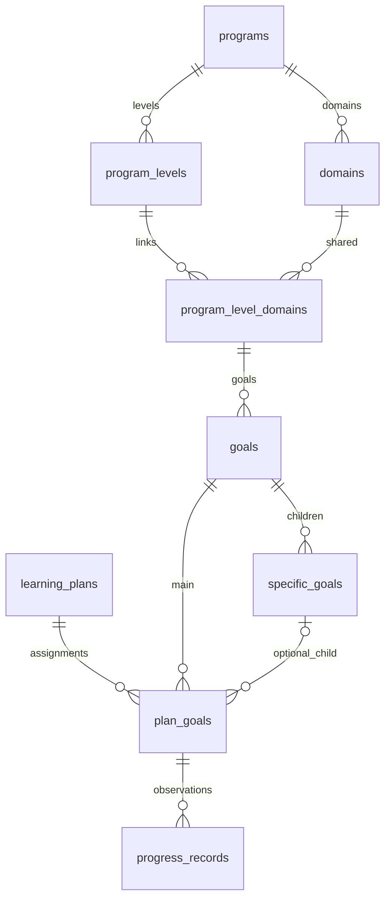

# Ngân hàng mục tiêu V8 — quan hệ cấp độ/lĩnh vực N–N

Áp dụng ngày 27/10/2026 trên **Docker `duong-an-mysql-1`, MySQL 8.4.13, `127.0.0.1:3308`, database `duong_an_v11`**. Không thao tác MySQL local 3306, không xóa database hoặc Docker volume, không tạo backup theo yêu cầu. V1–V7 được giữ nguyên.

## Database thực tế sau reset

- Giữ đúng 3 tài khoản đăng nhập ADMIN/TEACHER/PARENT; ID, email, role và mật khẩu BCrypt không thay đổi. Khi đăng nhập vẫn nhập mật khẩu bình thường.
- Xóa dữ liệu nghiệp vụ, gồm catalog Denver/VB, hồ sơ giáo viên/phụ huynh/học sinh, lớp học, kế hoạch, mục tiêu học sinh, quan sát, thu phí và các bảng nghiệp vụ phụ thuộc.
- Giữ cấu hình `center`, cấu trúc các module khác, bảng kỹ thuật `migration_v6_catalog_ids` và `catalog_id_sequences`.
- Sau kiểm thử, các bảng nghiệp vụ và 6 bảng catalog rỗng. Sáu bộ đếm catalog trở về `1`. **Chưa nhập lại Denver/VB vào dữ liệu sử dụng.** Các bộ import chỉ được kiểm thử trong transaction rồi rollback.
- Có 33 bảng và view `invoice_balance`. Không có `domains.program_level_id` hoặc `goals.domain_id`.

## Những bảng thay đổi

| Bảng | Thay đổi V8 |
|---|---|
| `domains` | Chuyển FK từ cấp độ sang `program_id`; unique `(program_id,code)`; một lĩnh vực dùng chung trong chương trình |
| `program_levels` | Thêm unique `(id,program_id)` để kiểm tra cùng chương trình bằng FK ghép |
| `program_level_domains` | Bảng mới: ID `LD`, cấp độ, lĩnh vực, thứ tự; unique `(program_level_id,domain_id)` |
| `goals` | Dùng `level_domain_id`; unique `(level_domain_id,code)` |
| `catalog_id_sequences` | Thêm bộ đếm `program_level_domains`; allocator khóa dòng và đối chiếu MAX(ID) sau import |
| `plan_goals` | Thay trigger tạo snapshot sang schema 4, có `level_domain_id`; giữ FK cha/con, snapshot bất biến và chống trùng |

`program_level_domains.program_id` là cột kỹ thuật bổ sung. Hai FK ghép tới `(program_levels.id,program_id)` và `(domains.id,program_id)` chặn liên kết sai chương trình, bao gồm INSERT/UPDATE bằng SQL trực tiếp. Cột `domains.display_order` được giữ để sắp xếp thư viện chung; thứ tự trong cấp độ nằm ở bảng liên kết.

`programs`, `specific_goals`, `learning_plans`, `progress_records`, `goal_criteria`, `student_goal_bank` và các bảng hồ sơ, lớp, tài chính giữ cấu trúc V7. Những cột bổ sung có sẵn như `specific_goals.expected_behavior`, `is_active`, thời gian tạo/cập nhật được giữ để tương thích nghiệp vụ.



## Backend và API

Giữ MVC: Controller → Service → Repository → MySQL. Bổ sung Spring Data JPA và 6 Entity/Repository tại `model/catalog` và `repository/catalog`. `CatalogGoalMapper` chuyển Entity thành DTO ngay trong transaction. EntityGraph tải cây mục tiêu/cấp độ/lĩnh vực/chương trình bằng một truy vấn; không tải collection con. Các truy vấn tổng hợp, ghi dữ liệu và khóa nghiệp vụ tiếp tục dùng JDBC chung transaction với JPA. Hibernate chỉ `validate`, không tự sửa schema; Open Session in View tắt.

Các file chính đã cập nhật: `GoalCatalogRepository`, `InterventionRepository`, `PlanGoalRepository`, `CatalogIdGenerator`, `GoalCatalogService`, `GoalTargetResolver`, `InterventionService`, `GoalCatalogController`, `InterventionController`, `SecurityConfig`, các DTO và `application.properties`, `pom.xml`. Thêm bộ `PlanProgressDtos`, `PlanProgressRepository`, `PlanProgressService`, `PlanProgressController`.

| API | Nội dung |
|---|---|
| `GET /api/programs/{id}/levels` | Cấp độ của chương trình |
| `GET/POST /api/programs/{id}/domains` | Lĩnh vực dùng chung của chương trình |
| `POST /api/levels/{id}/domain-links` | Gắn lĩnh vực có sẵn: `{domainId,displayOrder}` |
| `GET /api/levels/{id}/domains` | Lĩnh vực cấp độ; mỗi dòng trả `id` DM và `levelDomainId` LD |
| `POST /api/levels/{id}/domains` | API tiện ích tạo/tái sử dụng lĩnh vực theo code trong chương trình và gắn cấp độ |
| `GET/POST /api/level-domains/{id}/goals` | Mục tiêu đúng cặp cấp độ–lĩnh vực; `{id}` phải là LD |
| `GET /api/intervention/programs/{id}/domains` | Nhóm theo ID lĩnh vực dùng chung; mỗi độ tuổi có LD riêng |
| `GET /api/intervention/level-domains/{id}/targets` | Mục tiêu cho độ tuổi/lĩnh vực đã chọn |
| `GET /api/goals/{id}` | Denver: code/name/description, không query con; VB: con sắp theo display_order/id |
| `POST /api/intervention/students/{id}/preview` | Kiểm tra lựa chọn, trả token xem lại |
| `POST /api/intervention/students/{id}/complete` | Lưu learning_plans + plan_goals nguyên tử, chống gửi lặp |
| `PATCH /api/plans/{id}` | Sửa tên, ngày bắt đầu, trạng thái kế hoạch |
| `PATCH /api/plans/{id}/goals/{assignmentId}` | Sửa trạng thái mục tiêu đã giao |
| `GET/POST /api/plans/{id}/goals/{assignmentId}/progress` | Xem/lưu quan sát, số thành công/tổng cơ hội tùy chọn |

Các API ghi catalog, kế hoạch và tiến độ yêu cầu ADMIN và CSRF, giữ phạm vi quyền hiện tại. TEACHER/PARENT không được mở rộng quyền đọc hồ sơ/kế hoạch của học sinh khác. API catalog chỉ đọc yêu cầu đăng nhập.

Khi xem lại nhiều lựa chọn, tải thông tin cha theo lô và chỉ tải danh sách con cho những mục tiêu thuộc chương trình có hỗ trợ. Denver không truy vấn `specific_goals`; VB có con yêu cầu chọn con, VB không có con cho phép chọn cha. `plan_goals.goal_id` luôn có giá trị, `specific_goal_id` có thể NULL. FK ghép kiểm tra đúng cha/con. Các sửa đổi thư viện không ghi đè snapshot hoặc lịch sử quan sát.

## Frontend

- Thư viện → **Thư viện nội bộ** (`/#/library`): trang `GoalCatalogManager.tsx` dùng API thật để chọn/tạo chương trình, cấp độ, lĩnh vực chung, gắn lĩnh vực vào cấp độ, quản lý mục tiêu chính/con. Chỉ hiện thao tác ghi cho ADMIN.
- `RealInterventionPlans.tsx` và `InterventionDomainPicker.tsx` giữ 5 trang cũ. Dropdown độ tuổi dùng LD thay vì DM; DM dùng để nhóm lĩnh vực. Đổi độ tuổi xóa mục tiêu không còn thuộc lựa chọn đó. Đổi chương trình xóa bản nháp cũ. Effect hủy kết quả cũ để tránh response đến trễ ghi đè.
- `PlanProgress.tsx`: sửa thông tin kế hoạch, đổi trạng thái mục tiêu, ghi nhận và xem lịch sử quan sát. Mục lục kế hoạch hiển thị chương trình, cấp độ, lĩnh vực, mục tiêu và con nếu có.
- Cập nhật `goalBankApi.ts`, `interventionApi.ts`, `StudentGoalBank.tsx`, `AppRoutes.tsx`, `intervention-workflow.css` và các kiểm thử tương ứng; giữ màu và font của giao diện hiện tại.
- Các module ngoài phạm vi ngân hàng/kế hoạch vẫn giữ cách hoạt động trước đó; một số màn hình khác còn sử dụng dữ liệu frontend cục bộ.

## Hai bộ import từ dữ liệu thật

| File | Cấp độ | Lĩnh vực | Liên kết LD | Mục tiêu chính | Mục tiêu con |
|---|---:|---:|---:|---:|---:|
| [denver_v8.sql](imports/v8/denver_v8.sql) | 4 | 10 | 35 | 445 | 0 |
| [vb_v8.sql](imports/v8/vb_v8.sql) | 3 | 16 | 34 | 170 | 738 |

Nguồn gốc: `database/mysql/denver_insert_mysql_v6_1.sql` và `database/IMPORT_VB_SUA_LOI_1175.sql`. Không chạy các INSERT 1–N cũ lên schema mới. Giữ nguyên ID/mã/tên/mô tả mục tiêu và mã VB đã chuẩn hóa. ID DM/LD được ánh xạ lại, thứ tự mục tiêu trong nhóm gộp được đánh số liên tục.

Denver gộp các phần tự lập ăn/mặc/vệ sinh vào **Tự lập**, các phần chơi vào **Chơi**, các biến thể kỹ năng xã hội và **Hành vi chú ý chung** vào **Kỹ năng xã hội**. Đây là quy tắc gom nhóm thư viện dùng trong bộ import; nội dung mục tiêu không đổi. Đối chiếu hai file `*_domain_mapping.csv` để xem phần nguồn → lĩnh vực chung → LD. VB gộp theo mã lĩnh vực `VB.1`…`VB.16` xuyên các cấp độ.

Trước khi nhập:

1. Chọn đúng kết nối Docker `127.0.0.1:3308`, schema `duong_an_v11`; đóng transaction Workbench chưa kết thúc và tạm dừng thao tác ghi catalog.
2. Xác nhận V8 đã tồn tại; **không chạy lại reset hoặc migration V8** trên database hiện tại.
3. Xem bảng ánh xạ Denver, đặc biệt quy tắc nhóm chú ý chung nêu trên. Nếu muốn phân nhóm khác, sửa quy tắc chuyển đổi rồi tạo lại SQL trước khi nhập.
4. Chạy toàn bộ `denver_v8.sql`, sau đó `vb_v8.sql`, bằng UTF-8. File có transaction và cập nhật bộ đếm. Không bỏ qua lỗi duplicate/FK. Với Workbench, bật dừng khi có lỗi và chạy `ROLLBACK;` nếu nhập lỗi, không COMMIT phần còn lại.
5. Có thể dùng script CLI `import_catalog_v8.ps1 -Program denver` / `-Program vb`: MySQL CLI dừng khi lỗi và đóng connection, transaction không hoàn tất sẽ rollback.
6. Kiểm tra 2 chương trình, 7 cấp độ, 26 lĩnh vực, 69 LD, 615 mục tiêu, 738 con. Sau đó tạo hồ sơ thật, liên kết tài khoản giáo viên/phụ huynh vào hồ sơ mới và thử luồng tạo kế hoạch.

Chuyển đổi lại từ nguồn: `python database/mysql/tools/convert_catalog_v8.py`. Công cụ chỉ sinh file, không kết nối database và không tạo nội dung mục tiêu giả.

## Kiểm thử và thực thi

- Migration đã thực thi: [V8__shared_program_domains.sql](migrations/V8__shared_program_domains.sql), sau reset được xác nhận qua [reset_development_v8.ps1](reset_development_v8.ps1). Script reset có guard schema V7 và chỉ chạy một lần, không được dùng để xóa lại dữ liệu V8.
- Backend: **38/38** kiểm thử, gồm phân quyền, CSRF, FK N–N/sai chương trình, Denver/VB, snapshot, cập nhật thư viện, tạo/đọc/sửa kế hoạch, lưu/đọc quan sát, rollback và gửi hoàn thành đồng thời.
- Import: **1.364 kiểm tra** trong transaction rồi rollback, bao gồm đếm bảng, quan hệ và đối chiếu nguyên văn mã/tên/mô tả/độ tuổi với nguồn cũ. Không để lại catalog đã nhập thử.
- Frontend: **19/19** Vitest, **8/8** Playwright; có kiểm tra 5 trang, đổi độ tuổi làm sạch mục tiêu cũ, chọn nhiều mục tiêu, VB tải con khi mở, gửi hoàn thành lặp, sửa kế hoạch và lưu quan sát trên giao diện mobile.
- Backend/Frontend build thành công. Hibernate validate được kiểm tra lúc khởi động. Vite vẫn báo kích thước JS bundle lớn; đây không phải lỗi build.

Chạy lại trên database development đã rỗng:

```powershell
powershell -ExecutionPolicy Bypass -File database/mysql/test_goal_bank_v8.ps1 -DevelopmentEmptyDatabase
cd frontend
npm test
npm run test:e2e
npm run build
```

Runner V8 chỉ thao tác `duong_an_v11` đã xác nhận, không tạo/xóa database tạm hoặc volume. Nó yêu cầu dữ liệu nghiệp vụ rỗng, tự dọn fixture của test, so sánh checksum tài khoản trước/sau và đưa bộ đếm về 1 khi catalog rỗng. Không chạy runner ghi fixture trên database đã nhập dữ liệu sử dụng.
